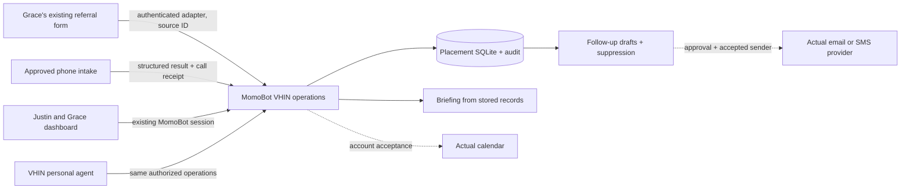

# Justin's placement operations system

Implementation design, October 20, 2026. Existing MomoBot is the product surface. The existing Placement Engine is the visual starting point; it is not the record store. This module does not replace Momentum's registry or task queue.

## Product decision

One VHIN placement workspace inside MomoBot. The dashboard is for Grace and Justin; chat is a second interface to the same authenticated operations, never a separate memory database. Start with Hillsborough. The assisted-living marketing business and later APD training remain separate scopes.

Base: $500/month platform access and approved business-reference memory. Standard Max Plus: the seven-role placement workflow with durable case/community memory, draft preparation, tours and fee tracking; the prior generic $1,250 proposal is superseded for this account. Justin's special Max Plus: $1,000 total including the base for that same workflow; special billing period is not established, so no invoice or recurring subscription is activated. Prices are internal commercial context, never dashboard content.

The first usable version includes structured records, a working operator UI, deterministic briefing and tests. A language model may turn approved case records into better prose; it cannot determine whether a save, booking, delivery or payment happened. Those facts come from persisted state and provider readback.

## Ownership and authority

- Justin decides family/community fit, confirms actual openings and move-in, and owns his business's relationship facts.
- Grace owns referral quality, workflow control, follow-up review and unresolved-case coordination.
- Sean owns the commercial scope and settlement of agreement terms.
- Dillon owns implementation and connector acceptance. The existing dillonmohr-36 session retains the original prototype/strategy/runtime work.
- The implementation binds to one explicit organization and workspace configured server-side. Only the configured user allowlist can access it; Grace and Justin see the same case store, with placement confirmation restricted to the configured Justin identity. The host-stamped organization must match. Audit records retain the actual actor. Real organization/member IDs must be verified before activation; configuration does not grant host membership. Do not use a shared password or a user ID from browser input.

## Deployed shape

The supported packaged extension registers private `/api/vhin` routes. Host authentication runs first; missing identity fails closed. SQLite lives under the operator-configured persistent data path, on one durable writer volume. This is placement-domain data, not a second agency queue. Readiness reports distinguish built workflow from unconnected phone/calendar/sender. No independent cron or new scheduler.

The preview is synthetic and private to the review. Production activation happens through the existing repository release/deploy route after review and connector acceptance; never manually edit an installed production copy.

## Records and boundaries

| Record | Required facts | Boundary |
| --- | --- | --- |
| Referral | stable ID, source submission ID, responsible contact, location, timeline, budget, assistance needs, preferences, owner, missing questions, stage, timestamps | One family case; no raw clinical history in agent persona or cross-client memory |
| Community | stable ID, licensed-directory source/date, locality, licensed capacity, services/pricing provenance, relationship owner | Capacity is not vacancy, care capability or payment eligibility |
| Availability | community, status, verifier, verification time, expiry, method/evidence | Unknown until verified; expired confirmation becomes unknown |
| Follow-up | case, draft body, purpose, preference, status, approval/delivery evidence where applicable | Draft only in this build; stop persists and suppresses further work |
| Tour | case/community, requested time and timezone, duration, state, calendar receipt | A proposal is not a booking; no confirmed state without connector evidence |
| Placement agreement | case/community, agreed integer cents, signed reference, move-in confirmation, installment dates | Human confirmation; no automatic legal interpretation or payment execution |
| Invoice / payment | case, amount cents, invoice/payment reference, date | Contracted, invoiced, due and collected remain distinct; receipts support cash entries |
| Audit | authenticated actor, object ID, action and time | Append-only operational history, not copied message bodies or secrets |

The source AHCA export contains 248 licensed facilities and 6,940 licensed beds according to the earlier build receipt. This implementation does not turn that dataset into current availability or silently call those statistics live. Real partner profiles enter only with provenance and verification. One synthetic community is sufficient for the acceptance run; public directory import is a separate idempotent import into this same store.

## State and event rules

1. `New`: referral accepted durably. Missing facts remain missing; urgent and human requests appear in the human-action briefing. A submission is acknowledged only after commit.
2. `Qualified`: completeness reviewed. Replaying the same unchanged source submission reuses its referral. A normalized contact collision returns the matching case IDs for human reconciliation; do not merge families automatically.
3. `Touring`: tour proposed with case/community linkage. Only a real calendar readback plus family/community acceptance can support a confirmed booking. Collision checks use absolute times, not local text labels.
4. `Placed`: Justin confirms move-in and an agreement reference establishes fee terms. Day 30 and day 60 are calculated from move-in, not the date the screen was opened. A normal $6,000 signed agreement produces two $3,000 milestones, not collected cash.
5. Reply, decline, stop or changed contact preference governs subsequent follow-up. Stop wins even if an old draft was already open in another tab. Every eventual sender rechecks suppression immediately before dispatch.
6. Failed external calls leave the prior truthful state intact and an actionable error. A timeout is unknown outcome: first query the destination using the original idempotency key. Never blindly retry a write through another connector.

## Exact integration contracts

| Integration | Existing evidence | Minimum contract to close | Outside check |
| --- | --- | --- | --- |
| Grace referral form | Work underway in Oct20 call; exact form ID not established | Map existing field names to referral schema; server-authenticated callback with stable submission ID, timestamps and replay protection. Never ship a second public intake form | Submit one synthetic source record twice; one case and one workflow, record readback after restart |
| CRM | Existing prototype only; Oct20 Composio HubSpot search returned no connected toolkit | Select the actual approved account before writing there. If an external CRM is authoritative, use the same case ID and provider object mapping; this store is the operational projection, never another independent pipeline | Read provider object ID and stage after write; replay unchanged |
| Phone | Brand source lists 813-678-2363, voice-only, rings Justin/Alvin; provider and transfer control unverified | Provider call ID, approved structured fields, urgency/human request flag, staffed transfer destination, callback fallback and transfer result | Routine/incomplete/duplicate/urgent/human-request simulations; one record each, actual transfer or explicit failed-transfer callback task |
| Calendar | Owner/calendar ID/scopes unverified | America/New_York; free-busy read and event create/read/update under the actual owner. Store provider event ID and original write key. Reject collision; reschedule cancels old occurrence before new confirmation | Provider readback proves start/end/attendees; denial leaves proposal |
| Email/SMS | No accepted VHIN sender or opt-out connector | Exact sender, channel preferences, approval actor, approved body version, suppression and delivery event. Voice-only business number is not an SMS sender | Stop cancels queued actions, zero sends after stop; delivery readback distinct from accepted API request |
| MomoBot agent | Justin-specific profile evidence is prepared; no production VHIN binding is installed | Provision under intended VHIN identity with only allowed operations; business persona excludes case health details and Dillon twin | Wrong user gets no records; intended user sees same case in chat and dashboard |
| Hosting/backup | Existing cloud migration is separately owned and not accepted | Install through reviewed extension path; attach persistent volume; online SQLite backup to the existing protected backup destination, restore into empty store | Restart + backup restore preserve stable IDs and counts; then prove flow with Mac off |

No vendor connection is claimed because a toolkit appears in a catalog. API keys stay server-side in the existing broker. Provider raw auth, codes and card data never enter case logs or review artifacts.

## Failure behavior and instrumentation

Incomplete intake returns saved state and a specific missing list. Unverified community facts remain unknown. Expired availability requires fresh human confirmation. Calendar denial leaves proposed. Sender denial leaves draft. A crash after database commit returns the same case on replay. A contact conflict creates a human reconciliation issue rather than an automatic merge. Unpaid fees remain due even when an invoice exists.

Record counts and readiness come from the current database. Usage and costs must come from provider receipts once model/provider operations exist. No fake ROI or time savings. Add this module's readiness to the existing MomoBot watcher; do not create another scheduler. One owning release writer and one database writer volume.

## First acceptance demonstration

Synthetic Maya requests Brandon assistance for a relative, budget $5,000 to $6,000, within 30 days. Save through the operations endpoint; repeat submission and show same ID. Review missing callback preference. Create a sourced synthetic community; show unknown vacancy, then an expiring human verification. Prepare a family follow-up; propose a tour without pretending it is booked. Confirm a synthetic move-in with a signed-reference placeholder and $6,000 fee, producing $3,000 at day30 and $3,000 at day60. Briefing must agree with each underlying record. Record stop, attempt another follow-up, and prove it is blocked. Restart and read the same case. Read the same record as another explicitly allowed teammate; reject an unlisted user and another organization, including a reused user ID.

## What acceptance still requires outside this code

Grace's exact form and approved CRM, calendar owner and booking scope, actual phone provider and staffed route, authorized sender/preferences, intended-user/shared-workspace permissions, required data arrangements, production persistent volume and backup/restore, and off-Mac execution. These are concrete account checks, not reasons to postpone building the core. Client sends remain with Dillon's explicit approval.
